# Family Story · 패밀리 스토리

## 제출 정보

| 항목 | 내용 |
|---|---|
| 앱 이름 | Family Story (패밀리 스토리) |
| 한 줄 소개 | 가족이 휴대폰에서 담은 여행 계획을 차량 내비로 바로 옮기고, 목적지마다 아이를 위한 이야기를 들려주는 Pleos Connect 차량용 앱 |
| 실행 방법 | 에뮬레이터를 켠 뒤 `adb install -r apk/FamilyStory_car_release.apk`로 설치하고, 앱 목록에서 **Family Story**를 실행합니다. 소스에서 빌드하는 방법은 [빌드와 실행](#빌드와-실행)에 있습니다. |
| 테스트 환경 | Pleos Connect 에뮬레이터(Android 14), JDK 17~23, Android SDK |
| 필요한 설정 | 없습니다. 내장된 경주 4곳은 설치만 하면 동작합니다. 새 장소의 사진·이야기 생성은 API 키를 넣고 직접 빌드했을 때만 켜집니다. 처음 실행할 때 나오는 권한 요청은 허용합니다. |
| 에뮬레이터 버전 | Pleos Connect Emulator v2.1.0 |
| 화면 규격 | 2560×1440, 가로 |
| APK 파일 위치 | [`apk/FamilyStory_car_release.apk`](apk/FamilyStory_car_release.apk) |

주행 상황은 에뮬레이터에서 **설정 › 연동 › 모의 정차 → 모의 이동 · 2분**으로 볼 수 있습니다(출발 안내 → 도착 안내 → 장소 이야기).

## 소개

**하나의 여행길, 우리 가족만의 서로 다른 이야기.**
가족이 휴대폰에서 담은 여행 계획이 차량의 목록으로 넘어오고, 목적지로 정한 장소마다 어른에게는 사진과 해설을, 아이에게는 그림책 이야기를 들려주는 Pleos Connect 차량용 앱입니다. 현대자동차그룹 차량용 앱 공모전 출품작입니다.

이 저장소에는 **차량용 앱**과 콘텐츠 생성 도구가 들어 있습니다. 함께 쓰는 휴대폰 앱은 저장소에 포함하지 않았고, 차량과 어떻게 연동하는지만 아래에 설명합니다.

## 무엇을 해결하나

어린 자녀와 자동차로 여행하는 가족을 대상으로, 두 가지 불편에 주목했습니다.

| 겪는 문제 | Family Story의 답 |
|---|---|
| 여행 계획을 차량 내비로 옮기려면 목적지를 한 곳씩 보내거나 차에서 다시 입력해야 한다. 동승자가 세운 계획은 운전자에게 전달한 뒤 또 입력한다 | 가족 누구나 휴대폰에서 장소를 담으면 차량의 목록에 들어오고, 운전자는 목록에서 한 번 눌러 차량 내비의 목적지로 정한다 |
| 이동 중 아이가 접하는 콘텐츠는 여행과 관련이 없어, 아이의 관심이 여행에서 벗어난다 | 목적지로 정한 장소마다 길잡이 캐릭터가 그곳이 어떤 곳인지, 무엇을 눈여겨보면 좋은지, 지킬 약속은 무엇인지를 그림책 이야기로 들려준다 |

## 차량 화면

탭은 세 개입니다. 차량 안에 별도의 지도를 두지 않고, 지도는 차량 내비 하나만 씁니다.

- **경로** — 가고 싶은 곳 목록과 "지금 가는 곳". 목록의 칸을 누르면 그곳이 목적지가 되고 차량 내비에 안내를 요청합니다. 내비의 현재·최근 목적지를 목록으로 가져올 수도 있습니다.
- **안내** — 일반 해설(실제 사진)과 키즈 그림책. 키즈 그림책은 쪽마다 배경, 그 장소의 친구(NPC), 길잡이 캐릭터, 소품을 조합해 보여 줍니다.
- **설정** — 가족 기기 연결과 권한, 여행 기록, 목소리, 차량 연동 상태.

아래는 Pleos Connect 에뮬레이터(v2.1.0, 2560×1440)에서 찍은 실제 화면입니다.

| 경로: 가족이 담은 장소 목록 | 목록에서 고르면 차량 내비에 경로가 잡힘 |
|---|---|
| 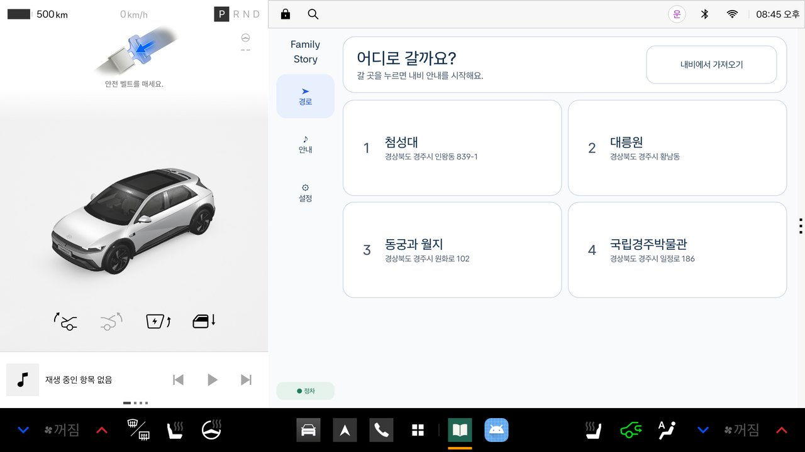 | 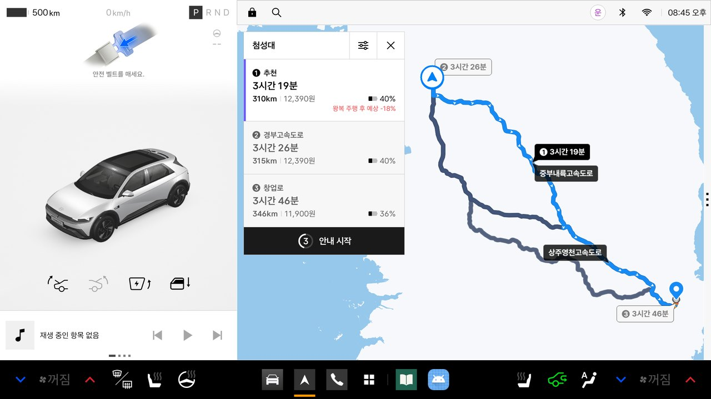 |

| 경로: 지금 가는 곳과 내비의 남은 시간 | 안내: 같은 장소의 일반 해설 |
|---|---|
| 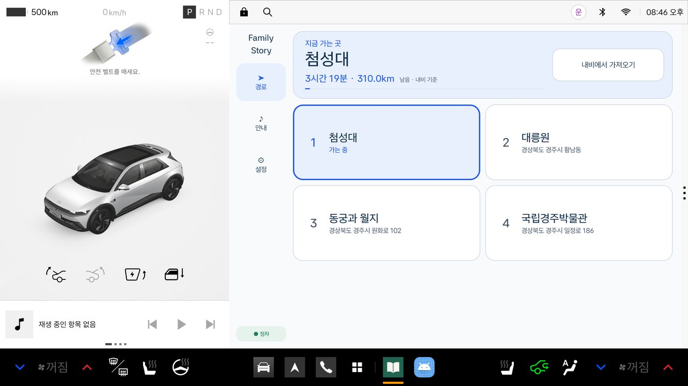 | 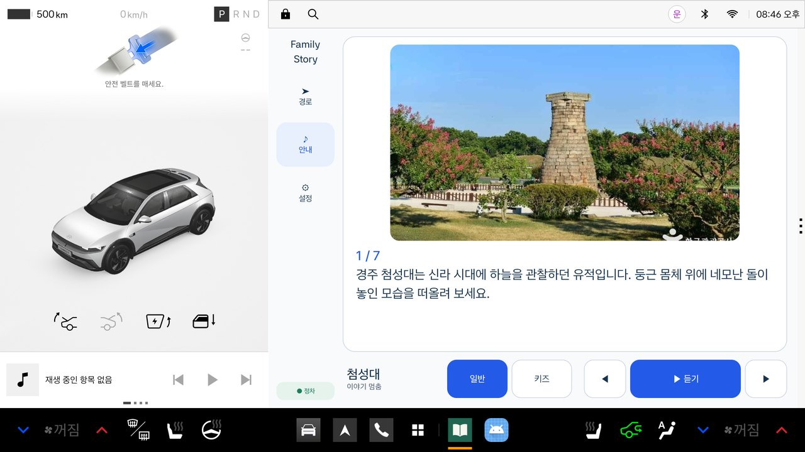 |

| 안내: 키즈 그림책 1쪽 | 안내: 키즈 그림책 2쪽 (소품과 다른 동작) |
|---|---|
| 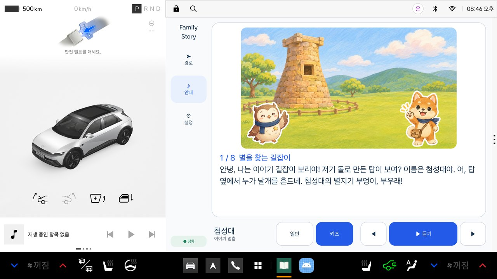 | 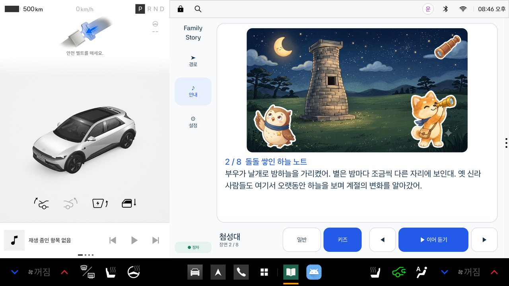 |

주행 중에는 화면이 한눈에 보이는 큰 글씨와 재생 버튼만 남고, 편집 기능은 정차(P단)에서만 열립니다. 확인 창과 알림은 시스템 팝업 대신 화면 안의 큰 패널과 알림 띠로 나옵니다.

## 휴대폰 앱과의 연동 구조

차량이 여행의 유일한 저장소이자 서버입니다. 클라우드 서버는 없습니다.

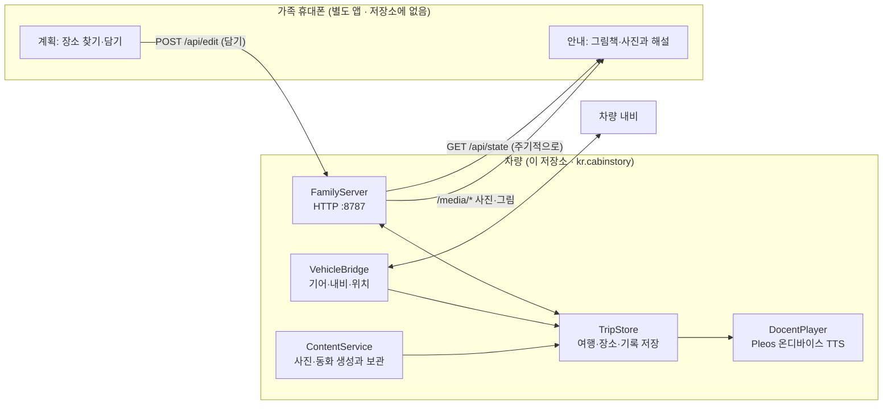

- **연결** — 차량 설정 화면에 나오는 초대 정보로 휴대폰 앱을 연결합니다. 지금은 서버 없이 같은 Wi-Fi(예: 차량 핫스팟) 안에서 차량에 직접 붙는 방식이며, 차량에서 공유를 끄면 모든 연결이 끊깁니다.
- **권한** — 연결한 기기는 바로 장소를 담을 수 있습니다. 차량에서 기기별로 보기만 / 장소 담기 / 담기와 정리 / 연결 해제를 정하고, 그 기기가 일반 안내를 볼지 키즈 안내를 볼지도 차량이 정합니다.
- **계획 → 차량** — 휴대폰은 연결 전에도 가고 싶은 곳을 미리 담아 둘 수 있고, 차에 타서 한 번에 보냅니다. 담은 장소는 승인 없이 차량 목록에 들어갑니다. 주행 중이면 차량이 "민지가 황리단길을 담았어요"라고 한 번 읽어 줍니다.
- **차량 → 휴대폰** — 휴대폰은 차량의 상태를 주기적으로 받아 옵니다. 상태에는 일정, 지금 가는 곳, 남은 시간과 거리, 차량이 지금 읽고 있는 장면, 주행·정차 여부가 들어 있습니다. 아이 휴대폰의 그림책은 차량이 읽는 장면에 맞춰 넘어갑니다.
- **콘텐츠 공유** — 사진과 동화 그림, 원고는 차량에서 한 번 만들어 차량에 보관하고, 연결된 모든 기기가 같은 것을 받아 봅니다. 한 번 만든 뒤에는 인터넷 없이도 보입니다.
- **원칙** — 차량이 유일한 작성자입니다. 휴대폰의 요청은 일정 번호(revision)가 맞을 때만 반영되고, 어긋나면 거절한 뒤 최신 상태를 다시 내려 줍니다. 목적지를 정하는 일은 차량에서만 할 수 있습니다.

## 사용한 Pleos Connect SDK

| 기능 | 쓰임 |
|---|---|
| NaviHelper | 목적지 안내 요청, 남은 시간·거리 수신, 도착 이벤트, 현재·최근 목적지 가져오기 |
| TTS (온디바이스 한국어) | 장소 이야기, 출발·도착 안내, 새 장소 알림 |
| Vehicle (기어) | 주행·정차에 따른 화면 전환과 편집 잠금 |
| FusedLocation | 내비 경로가 없을 때 직선거리로 남은 시간 어림, 250m 접근 감지 |

## 생성형 AI(Gemini) 콘텐츠 생성 테스트

새 장소의 키즈 콘텐츠가 실제로 만들어지는지 로컬 생성기 [Story Lab](tools/storylab/README.md)으로 시험했습니다. 장소 이름만 넣고, 이야기 틀·등장 친구·소품·배경·쪽 배치는 모두 생성기가 정하게 했습니다.

**결과: 전주 3곳(경기전 → 전동성당 → 덕진공원)의 콘텐츠 전체를 만드는 데 271초가 걸렸습니다.** (2026-11-15, 글 `gemini-4-argon`, 그림 `gemini-nano-banana-2.1`)

| 단계 | 만든 것 | 걸린 시간 |
|---|---|---|
| 소개문 가져오기 | 한국관광공사 자료 4건 조회(1건은 같은 이름의 관광지가 없어 건너뜀) | 2초 |
| 여행 이야기 틀 | 틀 "모으기", 제목 "전주 빛깔 조각 모으기", 장소마다의 친구와 선물 | 9초 |
| 장소 원고 × 3 | 곳마다 그림책 8쪽, 퀴즈 3개, 창밖 힌트, 회상, 도착 미션, 배경·소품 설명 | 20 · 21 · 22초 |
| 그림 × 12 | 곳마다 배경 2장, 친구 4동작 시트 1장, 소품 시트 1장 | 장당 13~23초 |
| 합계 | 그림책 24쪽, 퀴즈 9개, 친구 3명(12동작), 소품 13개, 배경 6장 | **271초 (곳당 약 90초)** |

- 원고 검증에서 버려진 항목은 없었고, 다시 쓰기도 일어나지 않았습니다.
- 장소가 하나의 이야기로 이어졌습니다. 두 번째 장소는 "두 번째 조각을 찾았네"로, 마지막 장소는 세 조각이 모이는 장면으로 끝납니다.
- 확인한 내용(대나무 숲, 성벽의 돌로 만든 주춧돌, 단오 창포물 등)은 관광공사 소개문에 근거가 있었습니다. 모든 문장을 대조하지는 않았습니다.
- 남은 문제: 5~7세에게 어려운 낱말(현수교, 주춧돌)이 섞이고, 한 쪽은 장소가 아닌 도시의 역사를 다뤘습니다.
- 생성 결과 전체는 [tools/storylab/out/run-jeonju-01](tools/storylab/out/run-jeonju-01)에 있습니다(`run.json`과 그림).
- 생성기는 퀴즈와 창밖 힌트도 함께 만들지만, 현재 차량 앱이 들려주는 것은 장소 이야기입니다. 퀴즈 등은 [이후 계획](#이후-계획)의 범위입니다.

생성된 그림의 일부입니다. 배경, 장소별 친구 캐릭터, 소품을 따로 만들어 화면에서 겹쳐 씁니다.

| | 경기전 | 전동성당 | 덕진공원 |
|---|---|---|---|
| 배경 | 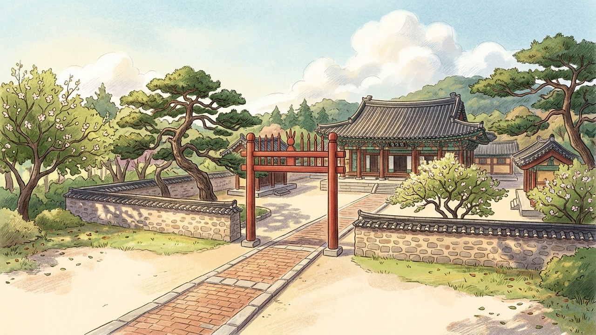 | 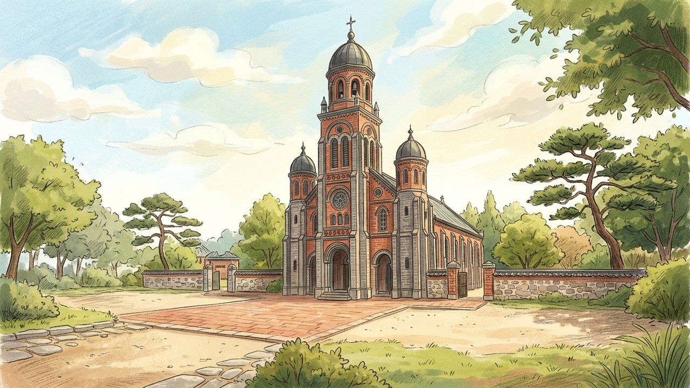 |  |
| 두 번째 배경 | 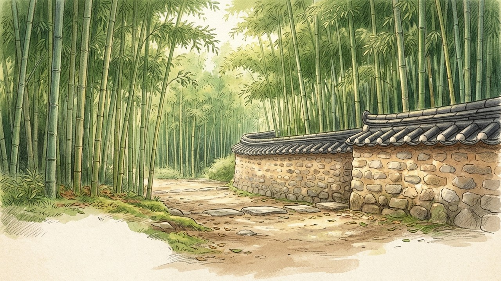 |  |  |
| 친구 캐릭터 |   |   |   |
| 소품 |    |  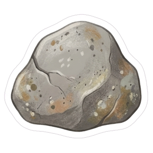  |    |

이 시험은 PC의 로컬 생성기에서 한 것입니다. 차량 앱 안의 생성 경로는 같은 지침(`StoryKit`)을 쓰지만 친구·소품·배경 생성은 아직 연결하지 않았고, 시연용 경주 4곳은 같은 방식으로 미리 만들어 앱에 넣어 두었습니다.

### 차량 앱에서의 생성 속도

차량 앱 안의 생성 경로도 Pleos Connect 에뮬레이터에서 따로 시험했습니다. 휴대폰이 하는 것과 같은 방식으로 차량의 가족 서버에 참여해 장소를 담았고, 차량 앱이 스스로 생성을 시작해 끝낼 때까지의 시간을 앱 로그로 쟀습니다.

**결과: 장소 한 곳에 평균 약 65초가 걸렸고, 새로 담은 3곳(불국사 → 석굴암 → 경주 양동마을)은 184초에 끝났습니다.** (2026-11-15, 글 `gemini-4-hydrogen`, 그림 `gemini-nano-banana-2.1`)

| 장소 | 자료 조회(TourAPI) | 글 | 그림 | 합계 |
|---|---|---|---|---|
| 국립경주박물관 | 0.9초 | 55.3초 | 17.2초 | 73.5초 |
| 불국사 | 1.0초 | 56.7초 | 16.6초 | 74.3초 |
| 석굴암 | 0.9초 | 35.2초 | 15.3초 | 51.4초 |
| 경주 양동마을 | 1.2초 | 41.2초 | 16.3초 | 58.7초 |
| 평균 | 1.0초 | 47.1초 | 16.3초 | **64.5초** |

- 네 곳 모두 그림책 8쪽, 퀴즈 3개, 사실 3개, 현장 미션이 생성 규격 검증을 통과했습니다. 본문은 곳당 800~970자, 그림은 배경 1장입니다.
- 위의 Story Lab 시험과는 만드는 양이 다릅니다. 여기서는 곳당 그림이 1장이고, Story Lab은 친구·소품·배경까지 4장을 만듭니다.
- 지금은 글과 그림, 장소를 차례로 하나씩 만듭니다. 동시에 요청하면 줄어들 여지가 있지만 시험하지 않았습니다.
- 응답 형식을 요청에 명시하기 전의 첫 시도는 모델이 JSON이 아닌 글로 답해 62초 뒤 버려졌습니다. 명시한 뒤로는 네 번 모두 통과했습니다.
- 확인한 네 곳의 첫 퀴즈 정답이 모두 1번이었습니다. 정답이 한쪽으로 몰리지 않게 하라는 지침이 지켜지지 않은 것으로, 고쳐야 할 부분입니다.
- 내비에서 가져온 영어 이름 장소 한 곳은 TourAPI에 소개 글이 없어 원고가 만들어지지 않았습니다.
- 시험용 생성 경로의 응답 속도이므로, 실제 서비스 환경에서는 달라질 수 있습니다.

차량 앱이 이 시험에서 만든 배경 그림입니다. 길잡이 캐릭터가 설 자리를 비워 두고 장소만 그리게 했습니다.

| 국립경주박물관 | 불국사 |
|---|---|
|  | 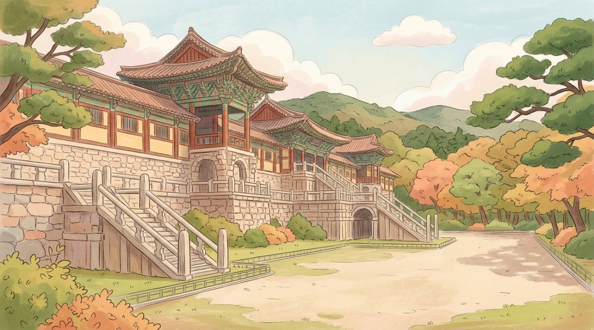 |

| 석굴암 | 경주 양동마을 |
|---|---|
| 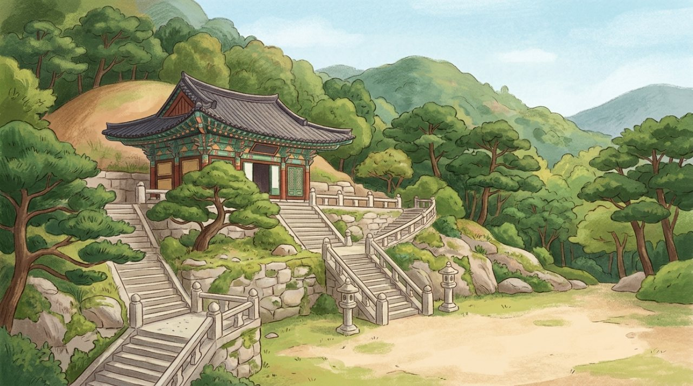 | 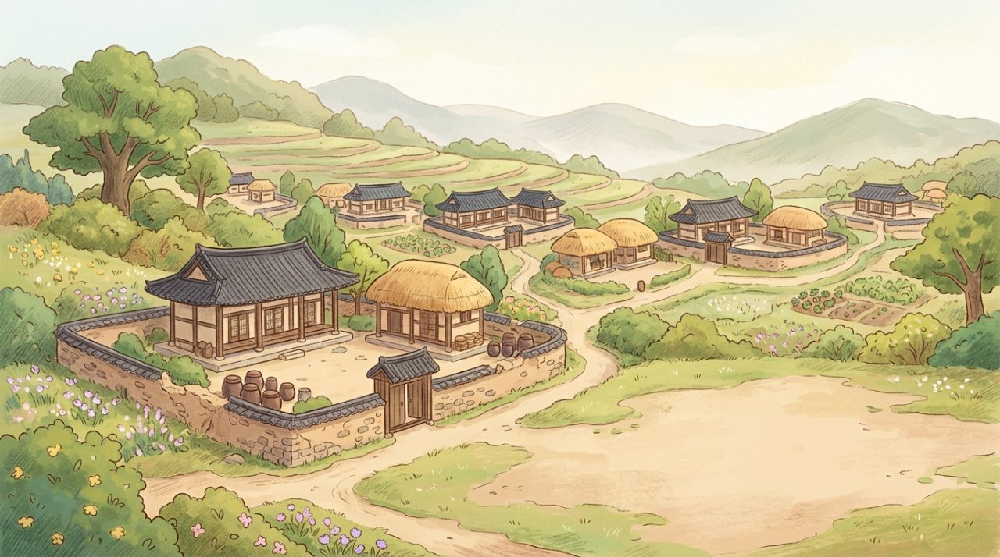 |

## 저장소 구성

| 경로 | 내용 |
|---|---|
| `app/` | 차량용 앱 소스 |
| `app/src/main/assets/places.json` | 내장 장소 4곳의 해설·그림책과, 이후 계획용으로 넣어 둔 퀴즈·이동 프로그램 원고 |
| `app/src/androidTest/` | 계측 테스트 42개(일정 규칙, 서버 권한, 이동 구간 문구, 생성 규격) |
| `tools/storylab/` | 로컬 콘텐츠 생성기와 시험 결과 |
| `scripts/cut_stickers.py` | 단색 배경 스티커 시트를 한 개씩 잘라 내는 스크립트 |
| `design/` | 캐릭터와 장소 그림의 원본 |
| `docs/` | 버전별 설계 기록 |
| `apk/FamilyStory_car_release.apk` | 서명된 차량용 APK |

주요 소스:

| 파일 | 역할 |
|---|---|
| `MainActivity` | 차량 화면 전체(경로·안내·설정, 확인 패널, 알림 띠) |
| `CabinSessionService` | 포그라운드 서비스. 이동 구간에서 무엇을 언제 말할지 정함 |
| `TripStore` | 여행·장소·권한·기록. 모든 변경의 규칙 |
| `FamilyServer` | 가족 기기용 HTTP 서버 |
| `VehicleBridge` | 기어, 내비, 위치 연동과 에뮬레이터 모의 시연 |
| `DocentPlayer` | Pleos TTS 재생 |
| `Journey` | 출발·도착 안내 문구(이후 계획용 퀴즈·놀이 편성 포함, 현재 꺼 둠) |
| `ContentService`, `StoryKit` | 새 장소의 사진·원고 생성과 생성 규격 |

## 빌드와 실행

필요한 것: JDK 17~23, Android SDK, Pleos Connect 에뮬레이터(v2.1에서 확인).

1. `local.properties`를 만들고 SDK 경로와 키를 넣습니다. 키가 없어도 빌드되고, 내장 4곳은 그대로 동작합니다.

   ```properties
   sdk.dir=C\:\\Users\\<이름>\\AppData\\Local\\Android\\Sdk
   TOUR_API_KEY=<한국관광공사 TourAPI 키>
   GEMINI_API_KEY=<Gemini API 키>
   GEMINI_IMAGE_MODEL=<그림 모델 이름>
   ```

2. 빌드합니다. 릴리스 빌드는 `signing/`에 서명 키가 없으면 새로 만듭니다.

   ```bash
   ./gradlew :app:assembleDebug
   ```

   공개할 APK는 `-PpublicBuild`를 붙여 키 없이 빌드합니다. APK에 컴파일된 키는 다시 꺼낼 수 있기 때문입니다. 이 저장소의 APK도 그렇게 만든 것이라, 내장 4곳은 그대로 동작하고 새 장소의 사진·원고 생성만 꺼져 있습니다.

   ```bash
   ./gradlew :app:assembleRelease -PpublicBuild
   ```

3. 에뮬레이터에 설치해 실행합니다.

   ```bash
   adb install -r app/build/outputs/apk/debug/app-debug.apk
   ```

에뮬레이터에서는 **설정 › 연동 › 모의 정차 → 모의 이동 · 2분**으로 한 구간(출발 안내 → 곧 도착 → 장소 이야기 → 도착 미션)을 2분 안에 들을 수 있습니다. 키즈 흐름은 먼저 안내 탭에서 "키즈"를 고릅니다.

## 확인한 것과 한계

- 계측 테스트 42개 통과([evidence/family-tests.txt](evidence/family-tests.txt)).
- Pleos Connect 에뮬레이터에서 실제 내비 안내 요청, 남은 시간 수신, 휴대폰 경로로 담은 장소가 차량 목록에 나타나는 것, 새 장소의 콘텐츠 생성, 화면 조합을 확인했습니다.
- 실차와 실물 휴대폰에서는 확인하지 못했습니다. 실제 주행으로 남은 시간이 줄어드는 과정도 에뮬레이터로는 볼 수 없었습니다.
- 차량과 휴대폰은 같은 Wi-Fi에 있어야 합니다.
- 차량 화면에서는 장소를 뺄 수 없고, '담기와 정리' 권한의 휴대폰에서 뺍니다.
- 소품과 장소별 친구 캐릭터는 미리 만든 경주 4곳에만 들어 있습니다. 차량 앱이 새 장소에서 만드는 것은 원고와 배경 그림입니다.
- 그림 속 유적은 동화풍으로 단순화돼 실제 모습과 세부가 다릅니다.

## 이후 계획

- **이동 시간이 긴 여행을 위한 콘텐츠** — 장소 이야기 사이에 그 장소에 관한 퀴즈 등을 넣어 분량과 종류를 늘립니다. 퀴즈·창밖 놀이·이어지는 이야기의 원고와 편성 코드는 저장소에 들어 있지만(`Journey.IN_TRANSIT_PROGRAM`), 현재 제출 범위가 아니어서 꺼 두었습니다.
- **여행 기록 보강** — 다녀온 장소에서 들은 이야기를 나중에 다시 볼 수 있게 합니다.
- **실제 휴대폰과의 연동 환경** — 지금은 같은 Wi-Fi에서 차량에 직접 연결합니다. 서버를 두어 차 밖에서도 계획과 콘텐츠를 주고받을 수 있게 하는 것이 다음 단계입니다.
- **소품과 친구 캐릭터의 자동 생성 연결** — 로컬 생성기에서 확인한 방식을 차량 앱의 생성 경로에 연결합니다.

## 문서

아래는 버전별 개발 기록입니다. 이전 버전의 범위(승인 절차, 이동 중 퀴즈·놀이 등)가 적혀 있으며, 현재 제출 범위는 이 README가 기준입니다.

- [0.3 구조](docs/family-story-v03.md) · [0.4 도착 흐름·장면 동기화](docs/family-story-v04.md) · [0.5 이동 시간의 콘텐츠화](docs/family-story-v05.md) · [0.6 계획 넘기기·창밖 모드](docs/family-story-v06.md)
- [0.7 차량 조작 단순화·승인 절차 제거·안내 분량 확대](docs/family-story-v07.md)
- [0.8 준비: 그림책 층 구성·로컬 생성기](docs/family-story-v08.md)
- [이전 README](docs/README-history.md)

## 출처

- 장소 사진과 소개문: 한국관광공사 TourAPI
- 장소 검색: Photon(OpenStreetMap)
- 캐릭터와 동화 그림: 생성형 AI로 제작
